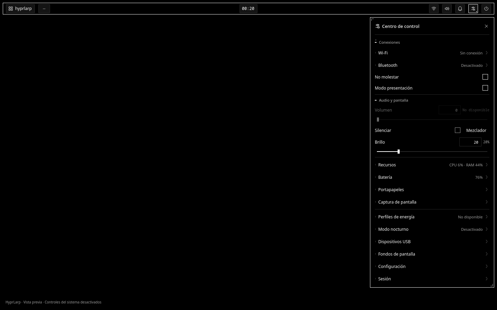
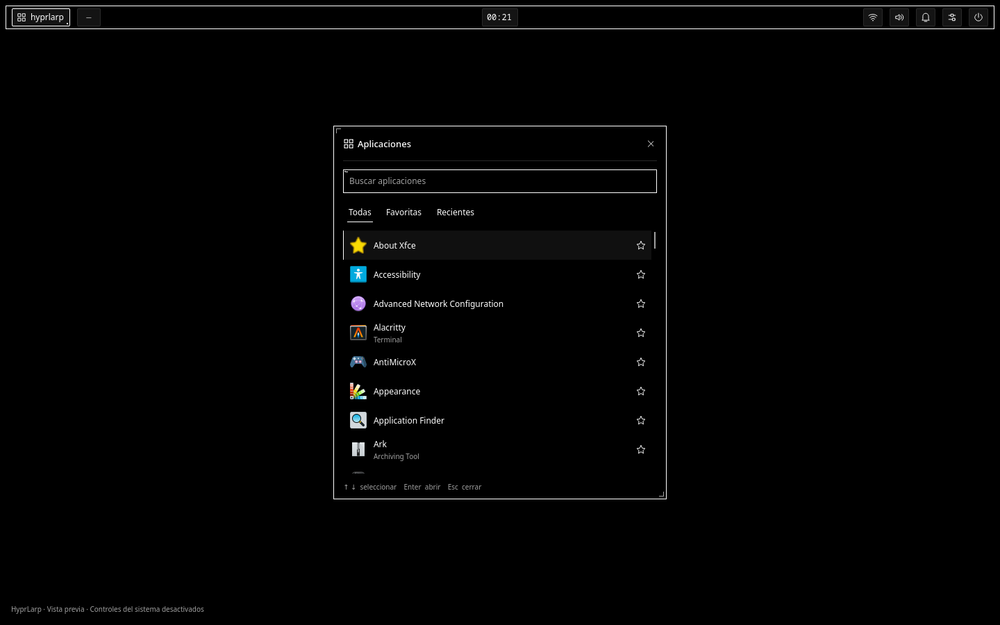
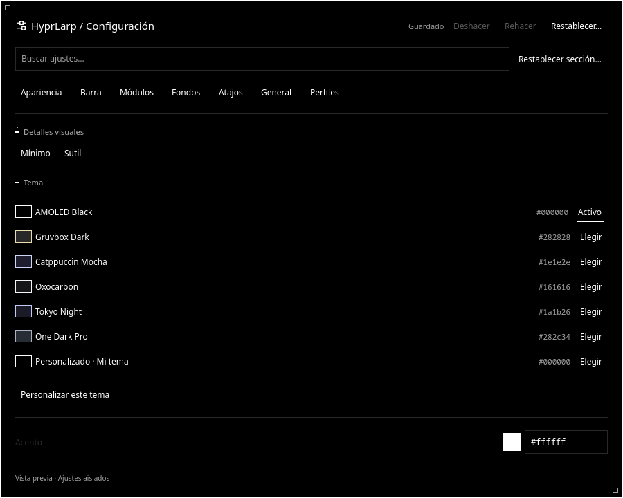
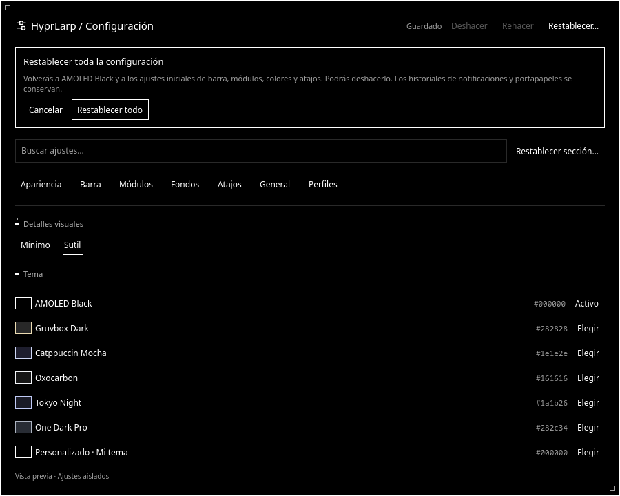
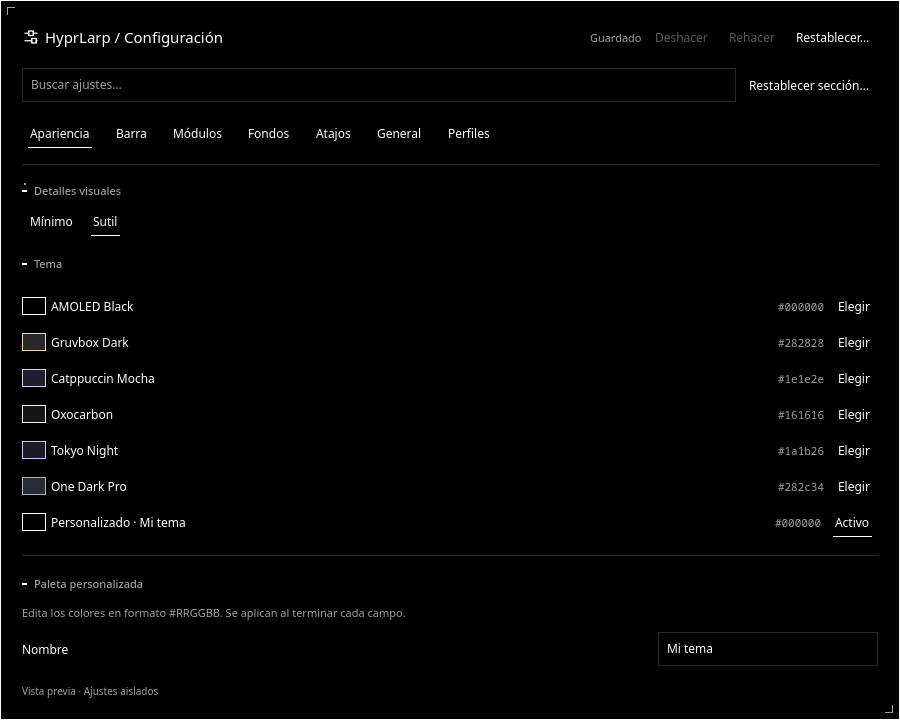
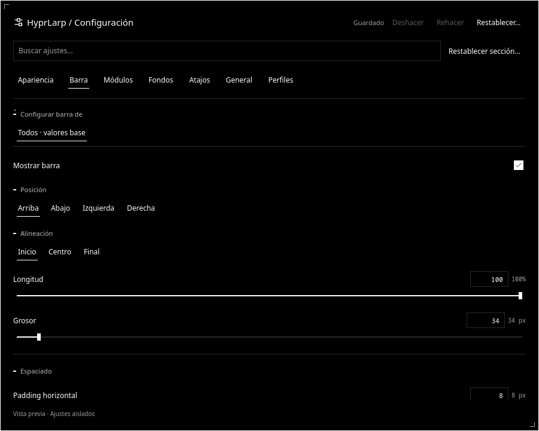
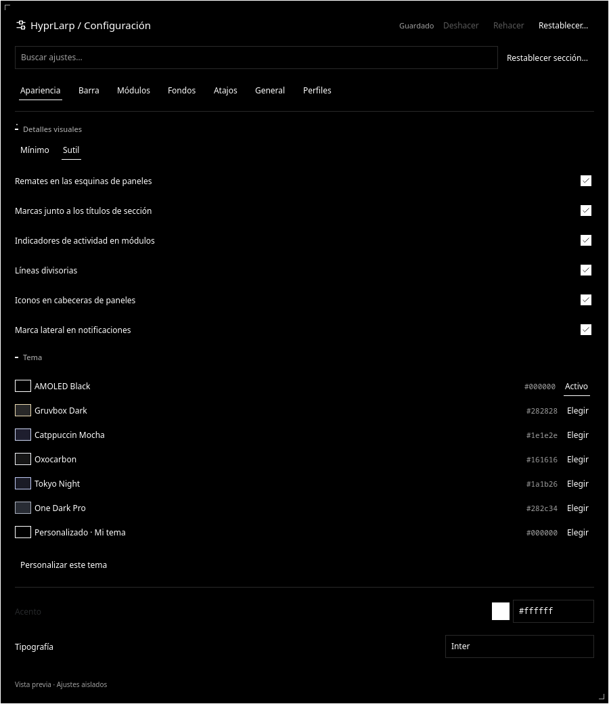
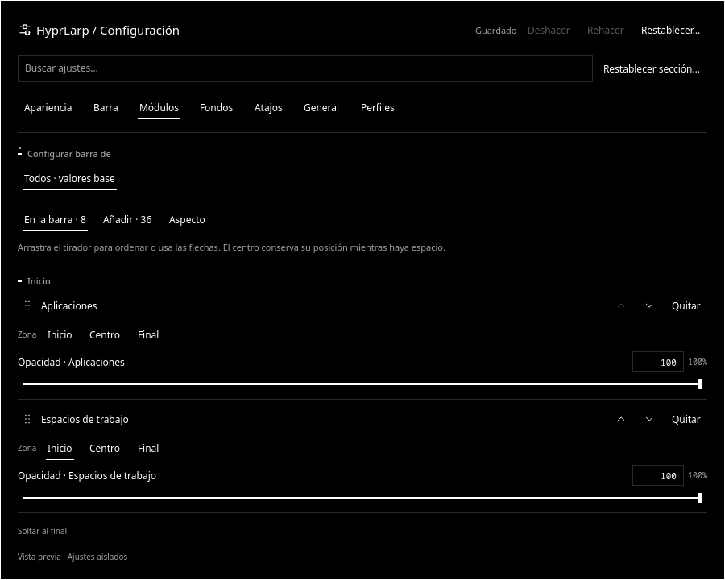
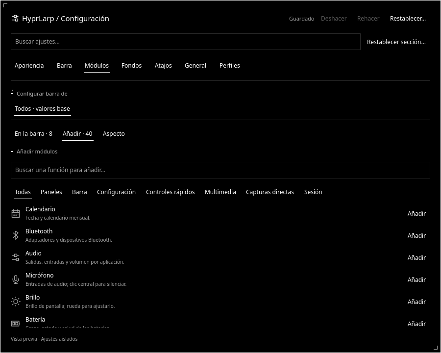
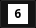

# HyprLarp

Un shell para Hyprland construido con **Quickshell / Qt Quick**, inspirado en la organización modular de [Noctalia](https://noctalia.dev/shell). **AMOLED Black**, negro puro y borde exterior blanco de 1 px. Cada módulo de barra tiene su propio fondo gris oscuro, borde discreto y radio de 2 px. La app incluye **Gruvbox Dark, Catppuccin Mocha, Oxocarbon, Tokyo Night, One Dark Pro** y un **tema personalizado**. No requiere instalar Noctalia.

La identidad del shell usa el gato con sombrero de `assets/icono-hyprlarp.png`, acompañado del nombre **HyprLarp**; el dibujo de `assets/icono-error.png` identifica los errores. Sus versiones SVG tienen fondo transparente y se adaptan a los colores del tema. Para regenerarlas y actualizar el icono genérico de aplicaciones después de editar los originales, ejecuta `python3 tools/prepare_branding.py` (requiere ImageMagick).

El icono de la aplicación instalada usa `assets/hyprlarp-desktop.svg`, con una base negra para conservar el contraste en los menús del escritorio.



## Probar desde el repositorio

Necesitas Quickshell **0.3.2+**, Qt 6 con Qt Quick Controls y Qt SVG, Python **3.11+** y **Hyprland 0.57+** con configuración Lua para usar las integraciones del sistema.

```sh
./bin/hyprlarp doctor
./bin/hyprlarp preview
```

La vista previa abre una ventana normal. Usa datos reales disponibles, no registra un daemon de notificaciones, no inicia la captura del portapapeles y desactiva acciones de red, audio, energía, USB y sesión. Tampoco aplica el filtro nocturno. Sus ajustes se guardan por separado en `$XDG_CACHE_HOME/hyprlarp/preview` (por defecto `~/.cache/hyprlarp/preview`). Puedes explorar aplicaciones, paneles, temas y la configuración sin sustituir tu escritorio; el botón Probar OSD muestra una demostración identificada como Prueba.

El launcher admite `= sqrt(81)+2`, `> configuración`, `? informe` y rutas como `~/Documentos/`. La [guía del launcher](docs/launcher.md) explica sus filtros y límites. En **Configuración → General → Estado del sistema** puedes comprobar la instalación y exportar un diagnóstico. También están disponibles `./bin/hyprlarp doctor --json` y `./bin/hyprlarp doctor --report /tmp/hyprlarp-diagnostico.json`; véase [diagnóstico](docs/diagnostics.md).

**Configuración → General** incluye [accesibilidad](docs/accessibility.md): texto hasta 200%, tamaño mínimo para etiquetas, alto contraste, controles grandes, movimiento reducido y navegación con teclado/AT-SPI. `> barra` en el launcher abre espacios, módulos y bandeja por teclado. El [aislamiento de fallos y modo de recuperación](docs/recovery.md) permite reintentar un componente o recuperar el shell sin borrar los ajustes ni cerrar las aplicaciones.

Los [temas por horario, estilos y diseños de panel, vistas previas y perfiles de rendimiento](docs/visual-performance.md) se configuran desde Apariencia y General. El perfil eficiente reduce sondeos y efectos; las lecturas siguen bajo demanda.

En Apariencia también puedes extraer localmente colores del fondo para usarlos como acento y ajustar un panel en una vista previa temporal antes de guardar el diseño.

El [panel de rendimiento](docs/performance-panel.md), en **General → Rendimiento del shell** o `> rendimiento` en el launcher, muestra CPU, memoria RSS/PSS, gráficos, arranque y carga de paneles. Permite guardar mediciones y comparar revisiones del paquete. El muestreo se detiene al cerrar el panel.

La [optimización verificada](docs/optimization-2026-11-19.md) reduce trabajo repetido en lecturas de batería, iconos, contraste, búsquedas, guardado del historial y sincronización de ajustes, conservando las funciones y la apariencia.

El [asistente de primera ejecución](docs/first-run.md) ayuda a elegir tema, diseño del panel, posición de la barra, rendimiento y accesibilidad, con vista previa y revisión antes de aplicar. Se ofrece automáticamente en instalaciones nuevas; puedes volver a abrirlo desde **Configuración → General** o con `hyprlarp welcome`.

El shell, el backend y el greeter comparten una [versión de publicación](docs/versioning.md) definida en `VERSION`. Consulta `hyprlarp --version` o `hyprlarp-greeter --version` sin necesitar una sesión gráfica.

Para iniciar el shell real desde este checkout:

```sh
./bin/hyprlarp run
```

Para probar sus notificaciones, una vez activo:

```sh
notify-send 'HyprLarp' 'Notificación de prueba'
```

Solo puede haber un servidor de notificaciones de escritorio a la vez. Si tu sesión inicia otro, cambia su entrada de arranque por HyprLarp para usar estos avisos e historial.

## Qué incluye

| Función | Implementación |
| --- | --- |
| Barra flotante | En todos los monitores; cuatro posiciones, ajustes por monitor y zonas inicio/centro/final; módulos con fondos individuales que se pueden añadir, quitar y reordenar arrastrando o con flechas. Espacios activos por monitor, actualizados mediante eventos de Hyprland. |
| Launcher | Centrado en la pantalla donde lo abres; busca aplicaciones, ventanas abiertas, archivos y acciones del escritorio. Incluye calculadora, favoritos, recientes y navegación con flechas y Enter. Usa los modelos nativos de Quickshell y búsquedas de archivos acotadas, sin indexador permanente. |
| Centro de control | Una columna de texto con Wi-Fi, Bluetooth, No molestar, volumen, brillo y acciones del sistema. Multimedia aparece solo si hay un reproductor. |
| Wi-Fi | Redes disponibles, búsqueda, conexiones guardadas o con contraseña y adaptador elegido; formulario visible y errores detallados mediante NetworkManager. |
| Bluetooth | Encendido, búsqueda acotada, conexión y desconexión con BlueZ. Vinculación con PIN, código de teclado o confirmación dentro del panel; recuerda y conecta el dispositivo. |
| Notificaciones | Avisos, acciones, No molestar, búsqueda, grupos y filtro por aplicación; reglas de avisos, historial y sonido por aplicación. |
| Portapapeles | Texto e imágenes con `wl-paste` / `cliphist`; fijados persistentes, miniaturas, pausa, búsqueda, caducidad opcional y limpieza sin borrar fijados. |
| Multimedia | Reproductores MPRIS, reproducción, anterior/siguiente, selección de reproductor y posición si la aplicación lo permite. |
| Reloj y calendario | Hora y calendario mensual con navegación; semana desde el lunes. |
| Sesión y bloqueo | Menú con confirmación para salir, reiniciar o apagar. Bloqueo nativo de `hyprlock` con logo, fondo, paleta, fuente y diseño lateral o centrado de HyprLarp. Suspensión con bloqueo a través de `hypridle`. |
| Capturas | Región, ventana activa y escritorio; temporizador; editor de recorte, flechas, texto y ocultación sólida; PNG guardado y copiado. |
| Recursos | CPU, RAM, disco, red, temperatura disponible y tiempo activo. Muestreo cada 2 segundos mientras se ve el módulo, Recursos o el centro de control. |
| Batería | Carga, salud/desgaste, capacidad actual y de diseño, ciclos, potencia, voltaje, temperatura, límites de carga y tiempo restante cuando el equipo los informa. Las estimaciones están identificadas. |
| Energía | Perfiles de ahorro, equilibrado y rendimiento mediante power-profiles-daemon; solo ofrece los perfiles compatibles con el equipo. |
| OSD | Indicadores de volumen, micrófono y brillo; posición superior/inferior y duración configurables. No aparecen al iniciar ni al sustituir un dispositivo. |
| Modo nocturno | Filtro cálido con hyprsunset, de 1000 a 6500 K, activación manual o por horario que admite cruzar medianoche. Desactivado inicialmente. |
| USB | Lista de periféricos conectados; montar, abrir, desmontar y expulsar unidades de datos con UDisks. Sin montaje automático. |
| Fondos | Selector de carpeta, ruta editable, miniaturas y fondos del tema; imagen elegida en cada monitor. Admite espacios, Unicode y caracteres especiales en la ruta. |
| Configuración | Buscador, campos numéricos, selector RGB, seis temas y paletas propias; perfiles, importar/exportar y reset por sección. Deshacer, rehacer y restablecer solo desde esta ventana. |
| Pantallas y proyección | Resolución, frecuencia, escala, orientación y posición visual; solo equipo, duplicar, extender y solo pantalla externa. Prueba de 20 segundos con recuperación independiente y diseños guardados por pantallas conectadas. |
| Audio | Selección nativa de salida/entrada, micrófono, silencio y volumen por aplicación con PipeWire. |
| Bandeja | Módulo opcional con iconos ocultables y menús contextuales nativos. |
| Presentación | Suprime avisos y sonidos e inhibe el reposo automático mediante Wayland mientras está activo. |

Los datos ausentes aparecen como no disponibles. No se simulan conexiones, canciones ni dispositivos. El soporte de reproducción y búsqueda de posición depende de las capacidades MPRIS de cada aplicación. Las redes empresariales/VPN usan `nm-connection-editor`; el gestor externo `blueman-manager` sigue disponible como opción. El botón Mezclador abre el panel nativo de audio.

En **Fondos**, pulsa **Elegir carpeta…** o escribe una ruta absoluta o con `~/` y pulsa **Aplicar ruta** o Enter. Los mismos controles están en **Configuración → Fondos**; desde la barra, Elegir carpeta abre esa página y su explorador. Se buscan PNG, JPG, JPEG, WEBP, SVG y BMP directamente en esa carpeta, junto con los fondos incluidos; **Actualizar** vuelve a leerla. Las miniaturas se crean al desplazarte y el catálogo se limita a 200 imágenes. **Usar fondo del tema** recupera el fondo liso. Deshacer los cambios sigue siendo exclusivo de configuración.

En **Configuración → Fondos → Gestor de fondos**, elige **Externo · Waypaper** para usar imágenes, GIF o vídeos con un gestor externo. HyprLarp descarga su superficie de fondo y las miniaturas internas; la barra y los paneles siguen por encima. **Abrir Waypaper** usa sus preferencias actuales; para vídeos selecciona **mpvpaper** dentro de Waypaper. Puedes restaurar el último fondo y activar su restauración al iniciar HyprLarp. Esa restauración está desactivada inicialmente. Volver a HyprLarp recupera la imagen anterior; Waypaper administra sus propios procesos. Véase la [guía de fondos externos](docs/waypaper.md).


Capturas de la implementación: [información de batería](docs/battery.png), [OSD de prueba](docs/osd.png), [modo nocturno](docs/night-light.png) y [preferencias del OSD](docs/general-settings.png).



Los iconos usan el tema instalado de Qt/GTK. Si la plataforma Qt no publica las rutas de iconos, el shell resuelve los archivos locales una sola vez y guarda los resultados en memoria. `QS_ICON_THEME=Papirus-Dark ./bin/hyprlarp run` permite elegir explícitamente un tema instalado; la variable está [documentada por Quickshell](https://quickshell.org/docs/v0.3.2/types/Quickshell/Quickshell/).



## Deshacer, rehacer y restablecer

La cabecera de configuración tiene **Deshacer**, **Rehacer** y **Restablecer…**. Estas acciones y sus atajos se habilitan únicamente mientras la ventana de configuración está abierta y enfocada. Fuera de ella, Ctrl + Z conserva el comportamiento de la aplicación activa. El historial registra exclusivamente los ajustes hechos desde configuración; los cambios realizados desde otros paneles del shell se conservan al deshacer o rehacer.

El historial conserva hasta **50 cambios de configuración**, incluidos Deshacer y Rehacer después de reiniciar el backend, el shell o la app independiente. Si se edita `settings.json` externamente, se descarta la pila que ya no corresponde a esos ajustes; las versiones anteriores siguen disponibles para comparar y restaurar. Cada arrastre de slider se guarda como una sola operación; el cambio de tema y su acento también se deshacen juntos.

| Atajo en configuración | Acción |
| --- | --- |
| Ctrl + Z | Deshacer |
| Ctrl + Shift + Z / Ctrl + Y | Rehacer |

**Restablecer… → Restablecer todo** recupera AMOLED y todos los ajustes iniciales, incluida la paleta personalizada. Puede deshacerse. Conserva los historiales de notificaciones y portapapeles. El botón **Restablecer sección…** afecta a la página actual; en Barra y Módulos respeta el monitor seleccionado. Los cambios de atajos se activan con **Aplicar atajos** en su pestaña, después de guardar toda la cola pendiente.



## Temas y colores personalizados

En **Apariencia**, elige AMOLED Black, Gruvbox Dark, Catppuccin Mocha, Oxocarbon, Tokyo Night, One Dark Pro o Papel Claro. La vista previa muestra muestras de barra, panel, acento y texto antes de aplicar. También puedes programar una paleta diurna y otra nocturna. **Personalizar este tema** crea una copia editable de la paleta activa; **Personalizado** recupera tu paleta guardada.

El editor permite dar nombre al tema y elegir un color con el selector RGB de cada muestra o escribirlo en formato `#RRGGBB` el fondo de escritorio, barra y paneles, hover, fondo de módulos, bordes, separadores, texto e iconos, texto secundario, acento y alertas. Se aplica al terminar cada campo y se guarda automáticamente. La paleta personalizada se conserva al elegir otro tema y al reiniciar; sus cambios admiten deshacer y rehacer. El bloqueo usa sus colores al abrirse.



## Redondez

En **Configuración → Apariencia → Redondez** puedes ajustar un radio general de **0–8 px** y definir valores independientes para barra, paneles y configuración, botones/casillas, campos, espacios de trabajo, avisos y ayudas emergentes. **Heredar radio general** elimina la excepción de ese tipo de elemento; 0 conserva las esquinas rectas. Estos cambios se guardan y admiten deshacer, rehacer y restablecer desde configuración.

La redondez de los módulos sigue en **Módulos → Aspecto → Radio**, también de 0–8 px y con los ajustes por monitor. Se ha eliminado el pequeño trazo decorativo superior de los módulos.

## Separación de ventanas

En **Configuración → Apariencia → Separación de ventanas** puedes ajustar la distancia a los bordes de la pantalla, con un valor común o uno por cada borde (**0–128 px**), y la separación interior entre ventanas (**0–64 px**). Mover un control activa la personalización y aplica el cambio; los valores se guardan, sobreviven a las recargas de Hyprland y admiten deshacer, rehacer y restablecer desde configuración.

Al desactivar **Personalizar desde HyprLarp**, se recarga la configuración original del compositor. Estos ajustes afectan a las ventanas en mosaico y se suman al espacio reservado por la barra. Las reglas particulares de un workspace pueden tener sus propios valores. Véase [separación de ventanas](docs/window-gaps.md).

## Perfiles y biblioteca

En **Configuración → Perfiles**, guarda la configuración actual con un nombre o guarda solo su paleta. Puedes mantener hasta 50 perfiles y 50 temas. Aplicar un perfil, importar o aplicar una paleta admite deshacer y conserva una copia previa en `settings.backup.json`. La biblioteca se guarda en `library.json`; no se elimina con Restablecer todo.

En la misma página, **Historial de configuración** conserva las últimas **30 versiones**. Pulsa **Comparar** para ver los valores actuales y guardados antes de restaurar. La restauración se puede deshacer; conserva No molestar, la pausa del portapapeles y los diseños de pantallas. El archivo privado `settings-history.json` tiene un presupuesto de 6 MiB. Véase [historial persistente](docs/settings-history.md).

Los botones Importar / Exportar usan JSON local con tipo y versión explícitos. Los perfiles incluyen apariencia, barra, módulos, ajustes por monitor y preferencias; excluyen el estado temporal de No molestar y la pausa del portapapeles. Los formatos inválidos se rechazan antes de cambiar la configuración.

La captura del portapapeles se pausa desde su panel. Los fijados son copias privadas de hasta 16 MiB por entrada y 50 entradas; siguen disponibles al vaciar cliphist. Las miniaturas se generan al necesitarse, con una caché de 16 imágenes. La caducidad se configura en General, está desactivada con 0 horas y cuenta desde que se observa cada entrada; no borra fijados.

Los sonidos de notificaciones están desactivados por defecto. En General puedes activar sonido y decidir avisos e historial por aplicación. Presentación se controla desde el centro de control o su atajo; inhibe el reposo automático mientras está activo sin modificar los tiempos de hypridle. El bloqueo manual sigue disponible.

El servicio intenta recuperarse con esperas de 1, 2 y 4 segundos, hasta tres intentos; los cambios de preferencias pendientes se conservan y se reenvían. Las acciones de red, sesión y capturas no se repiten automáticamente. El historial de deshacer del backend se vacía tras un reinicio.

## Pantallas y proyectores

En **Configuración → Pantallas** puedes organizar los monitores arrastrando, elegir sus modos y probar los cambios antes de guardarlos. **Super + Shift + P** abre Proyectar con las cuatro opciones de pantalla; Super + P conserva su bind anterior. La prueba se revierte en 20 segundos sin confirmación, incluso si se cierra el shell. Los diseños se recuerdan para cada combinación de pantallas. Véase [Pantallas y proyección](docs/displays.md).

## Ajustes de barra



Abre **Configuración → Barra** con el botón derecho sobre la barra o con `./bin/hyprlarp settings`.

| Ajuste | Opciones |
| --- | --- |
| Posición | Superior, inferior, izquierda o derecha. |
| Longitud y alineación | 25–100% del espacio disponible; inicio, centro o final. |
| Grosor | 22–128 px; el mínimo respeta el tamaño del contenido y el padding. |
| Padding | Horizontal y vertical, por separado. |
| Márgenes | Superior, derecho, inferior e izquierdo independientes; admiten cero. |
| Separación | Distancia entre módulos; admite cero. |
| Borde | 0–4 px, sólido y sin transparencia; blanco en AMOLED. |
| Opacidad | Fondo de la barra de 0 a 100%; el borde conserva su color. |
| Blur | Opcional, apagado inicialmente. Se solicita solo para la región de la barra. |
| Texto e iconos | Tamaños independientes, etiquetas y cantidad de espacios de trabajo. |
| Reserva de espacio | Permite que las ventanas respeten el área de la barra o la ocupen. |

En **Configuración → Apariencia → Detalles visuales**, elige **Sutil** para los pequeños trazos, indicadores y remates geométricos, o **Mínimo** para eliminarlos. Se conservan el negro AMOLED, los bordes sólidos, las esquinas pequeñas y los iconos monocromos. No se añaden sombras, brillos, degradados ni animaciones permanentes.



En esa página puedes activar o quitar por separado los remates de paneles, marcas de sección, indicadores de módulos, líneas divisorias, iconos de cabecera y marcas de notificaciones. **Mínimo** desactiva esos detalles sin borrar las elecciones; **Sutil** las recupera. Son ajustes de configuración con Deshacer/Rehacer y reset de Apariencia. El recuadro del workspace activo y las señales funcionales de selección se mantienen.

En **Configuración → Barra / Módulos**, selecciona Todos para los valores base o una salida concreta. Cada monitor hereda los valores base salvo sus ajustes explícitos; **Heredar todo** elimina esa personalización. Los monitores desconectados conservan sus preferencias.

Asigna los módulos a Inicio, Centro o Final; arrastra el tirador hasta un punto de inserción o usa las flechas. El reloj queda centrado si hay espacio; una barra demasiado corta permite desplazar el contenido sin superponer las zonas. **Quitar** y **Añadir** controlan qué módulos están presentes. Se puede dejar vacía y seguir abriendo los ajustes con el botón derecho. La opacidad se ajusta por módulo o de forma general. También puedes modificar la opacidad del fondo, el padding horizontal/vertical, el borde de 0–4 px y el radio de 0–8 px de los módulos. El grosor de la barra aumenta si hace falta para que el contenido no se corte.

Las funciones adicionales empiezan fuera de la barra; las funciones siguen disponibles por teclado y desde los menús. La bandeja se carga solo al añadir su módulo; sus iconos ocultos se configuran en Módulos. Los módulos que eliges permanecen en la barra: Presentación se puede activar desde su botón, y audio, multimedia o batería indican los datos ausentes sin inventarlos.

El catálogo reúne **50 módulos**. En **Módulos → En la barra** puedes quitar, mover entre zonas, reordenar y ajustar la opacidad de cada uno. **Añadir** permite buscar por nombre o función y filtrar por categoría; **Aspecto** contiene el estilo general y los iconos ocultos de la bandeja. Los mismos controles funcionan para cada monitor. Energía, modo nocturno, USB y ajustes del OSD se añaden desde ese catálogo; batería conserva su propio módulo.

| Categoría | Módulos disponibles |
| --- | --- |
| Paneles y barra | Aplicaciones, espacios de trabajo, reloj, calendario, Wi-Fi, Bluetooth, volumen, audio completo, micrófono, brillo, batería, notificaciones e historial, portapapeles e historial, multimedia, recursos, fondos, capturas y editor, centro de control, sesión, bandeja. |
| Configuración | App de configuración, temas y colores, perfiles/biblioteca/importación/exportación, atajos, ajustes de barra, gestión de módulos, reglas de notificaciones y preferencias del portapapeles. Abren la página correspondiente incluso si la ventana ya está abierta. |
| Controles rápidos | No molestar, presentación, pausa del portapapeles, silencio de salida y de micrófono. |
| Multimedia | Reproducir/pausar, pista anterior y siguiente. |
| Capturas directas | Región, ventana activa y escritorio completo. El módulo Capturas abre el temporizador y el editor. |
| Sesión | Bloqueo directo; suspender, cerrar sesión, reiniciar y apagar abren una confirmación. |

Cada entrada tiene fondo propio, icono, ayuda, opacidad y posición. Deshacer, rehacer y restablecer conservan su alcance exclusivo dentro de configuración.





El indicador muestra inicialmente **solo el espacio actual**, dentro de un recuadro completo con fondo claro y texto oscuro: `[6]`. La rueda recorre todos los espacios disponibles del monitor, incluidos los que no se muestran. Cada barra sigue el activo de su propia pantalla; los espacios especiales no se mezclan con la lista normal. Si Hyprland no informa el activo, se muestra `—`.

En **Configuración → Barra → Espacios** puedes elegir Solo actual, Actual y puntos o Números compactos. Los dos últimos conservan hasta cinco celdas; en Actual y puntos solo el activo tiene número. Los puntos de agrupación permiten activar el espacio oculto más cercano. La lista contempla los espacios 1–N configurados y los existentes con otros números o nombres.



El blur utiliza [BackgroundEffect de Quickshell](https://quickshell.org/docs/v0.3.1/types/Quickshell.Wayland/BackgroundEffect/). Necesita soporte del compositor y que el blur esté habilitado en él; la opacidad debe ser menor al 100% para verlo. La vista previa no reproduce el desenfoque del escritorio. No se modifica la configuración global de blur del compositor.

Las configuraciones anteriores se migran sin reescribir el archivo hasta que guardes cambios. Se conserva la posición, el orden de los módulos visibles, los atajos y los fondos personales. Se activan los iconos de aplicaciones; los nuevos atajos se añaden únicamente si no chocan con tus combinaciones guardadas.

## Dependencias en Arch / CachyOS

`doctor` comprueba qué herramientas están instaladas. Solo necesitas las correspondientes a los módulos que uses.

```sh
sudo pacman -S quickshell qt6-declarative qt6-svg python python-pillow networkmanager bluez bluez-utils \
  wireplumber brightnessctl wl-clipboard cliphist grim slurp hyprpicker hyprlock hypridle \
  playerctl imagemagick pipewire-audio inter-font ttf-jetbrains-mono
```

Editores opcionales:

```sh
sudo pacman -S nm-connection-editor blueman pavucontrol
```

Para Bluetooth integrado, energía, almacenamiento USB y modo nocturno:

```sh
sudo pacman -S power-profiles-daemon udisks2 python-gobject libnm hyprsunset
```

`python-gobject` proporciona GIO para Wi-Fi, Bluetooth, energía y almacenamiento USB; `libnm` permite enviar las contraseñas Wi-Fi directamente a NetworkManager, sin incluirlas en argumentos de procesos. Estos paquetes son opcionales para el resto del shell. La lista de periféricos USB se lee de sysfs. `doctor` comprueba las herramientas y el módulo Python, pero no confirma que los servicios estén activos. El modo nocturno gestiona una instancia propia de hyprsunset con configuración aislada; si ya tienes otra activa, muestra el conflicto y permite reintentar al cerrarla. Al salir de HyprLarp se detiene únicamente su filtro.

En **Configuración → General** puedes activar el OSD, cambiar posición/duración, probarlo y configurar el horario nocturno. El OSD automático se oculta durante Presentación; su prueba es explícita. Las unidades USB se consultan al abrir el panel o añadir el módulo y se actualizan con eventos. Expulsar pide confirmación y desmonta los volúmenes antes de apagar la unidad; si están ocupados, comunica el error sin forzar. Las unidades del sistema no ofrecen estas acciones.

También puedes elegir formato de hora y fecha, segundos, inicio del calendario y números ISO de semana, y configurar los avisos de batería baja y crítica. **Ctrl+F** busca ajustes y lleva al control correspondiente. Los errores incluyen un botón para copiar el mensaje. Véase [Preferencias de uso diario](docs/daily.md).

NetworkManager, BlueZ y PipeWire deben estar funcionando en tu sesión. El frontend no intenta habilitar servicios del sistema ni instalar paquetes.

## Instalar para tu usuario

Para que la pantalla de inicio de sesión de **greetd** siga el fondo, la paleta y la fuente de HyprLarp, puedes instalar la [HyprLarp Greeter](docs/greeter.md). Se configura por separado con `python3 tools/install_greeter.py` y sincroniza automáticamente los cambios de apariencia.

```sh
./install.sh --dry-run
./install.sh
```

Se copia el proyecto a `~/.local/share/hyprlarp`, se crea `~/.local/bin/hyprlarp`, el servicio de usuario `hyprlarp.service` y una entrada **Configuración de HyprLarp** en el launcher. Respeta `XDG_DATA_HOME` y `XDG_CONFIG_HOME`. La instalación conserva los ajustes válidos existentes y crea respaldos de las copias y archivos que sustituye. No edita tu archivo principal de Hyprland. Una instalación nueva se inicia con `hyprlarp start`; actualizar una instancia activa la reinicia con comprobaciones y vuelve a la versión anterior si el nuevo arranque falla.

El arranque de sesión generado usa `hyprlarp start`. El servicio recupera el shell tras un fallo, con dos segundos entre intentos y un máximo de tres arranques en cinco minutos. `hyprlarp stop` lo detiene expresamente; `hyprlarp run` conserva el arranque directo para desarrollo. Véanse [recuperación automática](docs/recovery.md) y [pantalla de bloqueo](docs/lockscreen.md).

La copia se prepara antes de sustituir la anterior. Los archivos reemplazados se conservan con sufijo `.backup-fecha`; ante un fallo de escritura se restauran. Un manifiesto con hashes identifica los archivos gestionados. El instalador rechaza destinos superpuestos o con enlaces simbólicos y bloquea instalaciones simultáneas. No copia `.git`, `.runtime`, `.preview`, archivos arbitrarios de la raíz ni cachés Python. No instala paquetes del sistema ni requiere sudo.

Para desinstalar conservando ajustes, notificaciones y portapapeles:

```sh
./uninstall.sh --dry-run
./uninstall.sh
```

Para quitar toda la carpeta de ajustes, incluidos historiales y respaldos internos, usa explícitamente:

```sh
./uninstall.sh --purge
```

La desinstalación detiene las instancias del shell instaladas y el hypridle que usa su archivo exacto de configuración; no detiene otros shells ni otros hypridle. Los archivos de programa modificados o ajenos y los respaldos fuera de la carpeta de ajustes se conservan. Sin `--purge`, también se conserva toda la carpeta de ajustes. Elimina el `dofile` de HyprLarp de tu `hyprland.lua` si lo añadiste: los scripts no editan ese archivo. También existen `hyprlarp install`, `hyprlarp uninstall` y `make uninstall`.

Puedes probar un ciclo completo en un destino aislado con `./install.sh --prefix /tmp/hyprlarp-demo`; usa el mismo `--prefix /tmp/hyprlarp-demo` al ejecutar `uninstall.sh`. Los modos `--dry-run` no crean ni borran archivos. El bloqueo de operaciones deja un archivo vacío `.hyprlarp-install.lock` en el directorio de datos; evita competir con otra instalación y no contiene datos personales.

Para conservar y personalizar tus binds, añade este bloque **antes del primer `hl.bind`** de `~/.config/hypr/hyprland.lua`:

```lua
local hyprlarpConfig = os.getenv("XDG_CONFIG_HOME") or (os.getenv("HOME") .. "/.config")
local prelude = hyprlarpConfig .. "/hyprlarp/bindings-prelude.lua"
local preludeFile = io.open(prelude, "r")
if preludeFile then
  preludeFile:close()
  dofile(prelude)
end
```

Conserva tu bloque actual de binds, incluidos callbacks, espacios y teclas multimedia. Para sustituir Noctalia, quita su arranque del bloque `hyprland.start`; si vas a usar el filtro nocturno de HyprLarp, quita también el arranque externo de `hyprsunset`. La guía [Migrar y personalizar binds](docs/binds.md) explica la transferencia y las opciones del editor.

**Al final del archivo**, carga la integración del shell:


```lua
local config = os.getenv("XDG_CONFIG_HOME") or (os.getenv("HOME") .. "/.config")
local hyprlarp = config .. "/hyprlarp/hyprlarp.lua"
local file = io.open(hyprlarp, "r")
if file then
  file:close()
  dofile(hyprlarp)
end
```

El archivo incluye el arranque del shell, `hypridle` y los atajos generados. Si ya gestionas `hypridle`, integra el contenido de `~/.config/hyprlarp/hypridle.conf` en tu configuración en vez de iniciar dos instancias. El botón Suspender comprueba que la instancia de `hypridle` de HyprLarp esté activa.

El aspecto de ventanas del rice es opcional:

```lua
local data = os.getenv("XDG_DATA_HOME") or (os.getenv("HOME") .. "/.local/share")
local rice = data .. "/hyprlarp/config/hyprland-look.lua"
local file = io.open(rice, "r")
if file then
  file:close()
  dofile(rice)
end
```

Este archivo aplica separación, bordes blancos de 1 px, esquinas rectas y desactiva las sombras del compositor. La separación también puede personalizarse desde Apariencia; cuando está activada, prevalece sobre los valores de este archivo. El bloqueo recibe los colores del tema actual al abrirse, a partir de la plantilla `config/hyprlock.conf`.

## Atajos y comandos

| Atajo inicial | Acción |
| --- | --- |
| Super + Espacio | Aplicaciones |
| Super + M | Centro de control |
| Super + N | Notificaciones |
| Super + V | Portapapeles |
| Super + Ctrl + M | Multimedia |
| Super + C | Calendario |
| Super + W | Fondos |
| Super + X | Sesión |
| Super + Coma | Configuración |
| Super + Ctrl + W | Wi-Fi |
| Super + Ctrl + B | Bluetooth |
| Super + Ctrl + R | Monitor de recursos |
| Super + Ctrl + P | Batería |
| Super + Ctrl + E | Perfiles de energía |
| Super + Ctrl + L | Modo nocturno / descanso visual |
| Super + Ctrl + U | Dispositivos USB |
| Super + Ctrl + O | Configuración del OSD |
| Super + Ctrl + S | Menú de capturas |
| Super + Ctrl + A | Audio y micrófono |
| Super + Ctrl + D | Activar/desactivar Presentación |
| Super + L | Bloquear |
| Impr Pant / Shift + Impr Pant | Región / escritorio |
| Super + 1…9 / Super + 0 | Espacios 1…9 / espacio 10 |
| Escape | Cerrar el panel abierto |
| ↑ / ↓ / Enter | Seleccionar / abrir en el launcher |
| Volumen + / − / Silenciar | Audio del sistema |
| Silenciar micrófono | Micrófono del sistema |
| Brillo + / − | Brillo de pantalla |
| Reproducir / pausa, anterior, siguiente | Reproductor multimedia |

Dentro de **Sesión**, pulsa **1** para bloquear, **2** para suspender, **3** para cerrar sesión, **4** para reiniciar o **5** para apagar. Las opciones 2–5 piden confirmación: **Enter** confirma y **Escape** cancela. Otro Escape cierra el menú. Los números aparecen junto a cada opción y también funciona el teclado numérico.

**Super** es la tecla Windows. Los atajos globales necesitan la inclusión de `hyprlarp.lua`; no se instalan con la vista previa. Puedes editar los de los paneles en **Configuración → Atajos** y aplicarlos con el botón de esa página. Un campo vacío desactiva ese atajo. El gestor conserva los binds existentes y omite los nuevos que entren en conflicto; no regenera tus espacios ni tus teclas multimedia. Configuración → Atajos permite añadir, eliminar y editar comandos o acciones del shell. En Actuales en Hyprland puedes cambiar la combinación de una acción Lua conservando sus callbacks, o desactivarla. Reemplazar coincidencias es una elección explícita por bind. Super + S y Super + Shift + S conservan tus acciones del espacio especial. La rueda ajusta volumen, micrófono o brillo en su módulo; el clic central silencia volumen o micrófono; el botón central sobre multimedia reproduce/pausa y el botón derecho sobre un módulo abre su gestión dentro de configuración.

```sh
hyprlarp settings
hyprlarp toggle wifi
hyprlarp toggle bluetooth
hyprlarp toggle audio
hyprlarp toggle presentation
hyprlarp toggle resources
hyprlarp toggle energy
hyprlarp toggle night-light
hyprlarp toggle usb
hyprlarp toggle osd
hyprlarp toggle wallpapers
hyprlarp close
hyprlarp screenshot-region
hyprlarp screenshot-region --freeze
hyprlarp lock
```

Desde el checkout, sustituye `hyprlarp` por `./bin/hyprlarp`. Los comandos IPC se dirigen a la copia desde la que se ejecutan; usa el ejecutable instalado para controlar el shell instalado.

## Configuración y desarrollo

La barra usa eventos de Hyprland por monitor y audio nativo de PipeWire. Bluetooth se actualiza mediante BlueZ; los cambios de conexión de NetworkManager disparan una lectura, sin búsquedas Wi-Fi periódicas en segundo plano. CPU/RAM se muestrean solo mientras se necesitan; brillo se lee de sysfs cuando se muestra y al recibir eventos de backlight para el OSD; batería se lee cada 30 segundos en la barra o cada 2 segundos en su panel. Energía y USB se actualizan por eventos mientras sus módulos o paneles los necesitan. El horario nocturno comparte el reloj de minutos; el OSD solo mantiene un temporizador mientras está visible. Las tareas de lectura se agrupan para evitar colas de procesos. Los paneles se destruyen al cerrarse; las listas de aplicaciones reutilizan los elementos visibles y los iconos se cargan de forma asíncrona. No se reduce la calidad de renderizado del escritorio.

La metodología y los resultados de la medición están en [docs/performance.md](docs/performance.md). La lista para validar monitores, escalado, integraciones y suspensión está en [docs/validation.md](docs/validation.md). Para repetir una muestra aislada:

```sh
python3 tools/benchmark.py --seconds 12
python3 tools/benchmark.py --seconds 12 --panel resources
```

La configuración vive en `~/.config/hyprlarp/settings.json`. La app agrupa los cambios y los guarda mediante escritura atómica, con una escritura en curso como máximo. `config/modules.json` es el catálogo compartido por la validación y la interfaz; `config/defaults.json` contiene el esquema inicial; la validación, deshacer/rehacer y el protocolo JSON están en `backend/service.py`. Las paletas incluidas están en `config/palettes.json`; la personalizada, en `customPalette` dentro de tus ajustes. `HYPRLARP_STATE_DIR` permite usar un directorio aislado.

```text
HyprLarp.qml        Ventanas, IPC y composición del shell
core/              Estado, temas, puente, notificaciones y MPRIS
components/        Controles e iconos vectoriales propios
widgets/           Barra, fondo, panel flotante y configuración
panels/            Funciones del escritorio
backend/           Integraciones; biblioteca estándar y GIO/libnm para dispositivos y Wi-Fi
config/            Valores iniciales y estilos del compositor/bloqueo
assets/            Fondos y marca originales en SVG
tools/             Instalación y comprobación de la interfaz
tests/             Pruebas de persistencia, parsers y límites de las acciones
```

```sh
make check
# Solo backend, sin Quickshell:
python3 -m unittest discover -s tests -v
```

La comprobación completa abre los 19 paneles, las ocho páginas de configuración, las cuatro posiciones de barra, valores a cero, barras cortas, los seis temas incluidos y el personalizado con el renderizador offscreen de Qt y ajustes temporales. Comprueba la navegación de los 50 módulos, las páginas de configuración y las confirmaciones de sesión; los modos visuales Mínimo y Sutil; el selector RGB, las anotaciones, los flujos de audio y la recuperación tras terminar el backend de prueba; añadir, quitar y reordenar módulos, incluyendo una barra vacía; también deshacer/rehacer cambios pendientes y guardados, revertir un reset, agrupar sliders, conservar la paleta y aplicar colores claros personalizados. Comprueba el OSD de prueba, su caducidad y desactivación, el historial de sus preferencias y del modo nocturno, y elegir una carpeta e imagen con espacios y caracteres especiales hasta comprobar su renderizado. La vinculación Bluetooth, sus confirmaciones y cancelaciones se verifican con BlueZ simulado. Las pruebas de lógica cubren errores de escritura, validación de colores, límite del historial, espacios por monitor, planificación del muestreo, telemetría de batería, horarios nocturnos, perfiles compatibles y operaciones USB con servicios simulados; las del modelo de espacios usan Node si está disponible, solo para desarrollo. Los archivos Lua se verifican con `Hyprland --verify-config` cuando está instalado. El renderizado está comprobado con Quickshell 0.3.2 y la configuración con Hyprland 0.57; los cambios físicos de monitor, las conexiones, el bloqueo/PAM, la suspensión, el OSD nativo, energía, USB, el filtro nocturno y las acciones de sesión deben verificarse en una sesión real. La vista previa no valida esos servicios.

El código usa indentación de **2 espacios** en QML, Python, JavaScript, JSON, Lua y configuración. `.editorconfig` y `.qmlformat.ini` conservan esta convención. Las reglas visuales están en [docs/design.md](docs/design.md).

El bloqueo utiliza la autenticación de `hyprlock`; HyprLarp no recibe ni almacena contraseñas de sesión. La suspensión usa la [integración de `hypridle`](https://wiki.hypr.land/hypr-ecosystem/user/hypridle/) con `inhibit_sleep = 3` para esperar el bloqueo antes de dormir. El shell no incluye grabación de pantalla, greeter ni plugins de Noctalia.

## Referencias

- [Quickshell: tipos y servicios](https://quickshell.org/docs/v0.3.1/)
- [Notificaciones de Quickshell](https://quickshell.org/docs/v0.2.1/types/Quickshell.Services.Notifications/NotificationServer/)
- [MPRIS de Quickshell](https://quickshell.org/docs/v0.2.1/types/Quickshell.Services.Mpris/MprisPlayer/)
- [Noctalia, referencia de organización](https://noctalia.dev/shell)
- [Hyprland: configuración Lua](https://wiki.hypr.land/configuring/core/)

Código, iconos y fondos incluidos bajo [MIT](LICENSE).

La revisión de recursos, seguridad, instalación y resultados de validación está en [docs/review.md](docs/review.md). El portapapeles limita cada captura a 16 MiB antes de entregarla a cliphist y usa memoria anónima, sin archivos temporales intermedios. Las miniaturas aceptan formatos raster reconocidos y tienen límites de proceso. Los datos internos usan directorios privados y archivos de estado de modo 600.

La guía de [binds actuales y personalizados](docs/binds.md) detalla el preludio, la transferencia de Noctalia y la edición sin reescribir tu configuración de Hyprland.

## Desarrollo y comprobaciones automáticas

El workflow `.github/workflows/check.yml` ejecuta la lógica con Python 3.11 y 3.14, y la comprobación completa de Qt/Quickshell en un contenedor Arch. No controla dispositivos físicos. Se conservan los registros, versiones y una muestra de rendimiento offscreen como artefactos durante 14 días. Véase [desarrollo y CI](docs/development.md).
