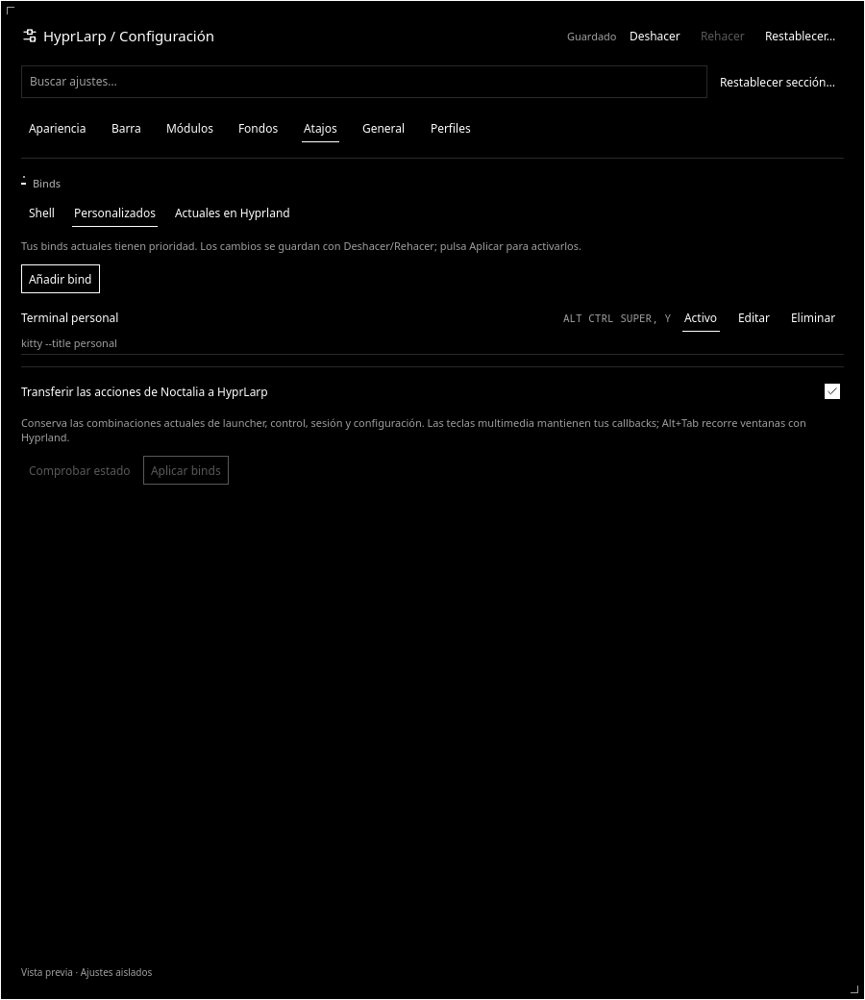

# Binds actuales y personalizados

HyprLarp conserva tus combinaciones y permite gestionar las personalizaciones desde **Configuración → Atajos**. El archivo principal de Hyprland conserva sus declaraciones originales: el gestor mantiene los handlers nativos, incluidos bucles, funciones Lua y callbacks al soltar. Las personalizaciones se guardan en `settings.json` y el archivo generado `bindings.lua` se actualiza al pulsar **Aplicar binds**.



## Instalar la integración

Desde el repositorio ejecuta `./install.sh`. Para actualizar una instalación anterior, vuelve a ejecutar el mismo script; conserva los ajustes válidos y hace respaldos.

En `~/.config/hypr/hyprland.lua`, coloca este bloque **antes del primer `hl.bind`**, preferentemente al principio:

```lua
local hyprlarpConfig = os.getenv("XDG_CONFIG_HOME") or (os.getenv("HOME") .. "/.config")
local prelude = hyprlarpConfig .. "/hyprlarp/bindings-prelude.lua"
local preludeFile = io.open(prelude, "r")
if preludeFile then
  preludeFile:close()
  dofile(prelude)
end
```

Conserva después tu bloque de binds actual. Al final del archivo, carga la integración:

```lua
local hyprlarpSession = (os.getenv("XDG_CONFIG_HOME") or (os.getenv("HOME") .. "/.config")) .. "/hyprlarp/hyprlarp.lua"
local sessionFile = io.open(hyprlarpSession, "r")
if sessionFile then
  sessionFile:close()
  dofile(hyprlarpSession)
end
```

Para cambiar el shell, comenta únicamente el arranque `hl.exec_cmd("noctalia")` en `hyprland.start`. Si usas el modo nocturno de HyprLarp, comenta también el arranque externo de `hyprsunset`. Conserva `hyprpolkitagent`. Cierra sesión y vuelve a entrar para cambiar los procesos de arranque. El instalador no edita este archivo por su cuenta.

El preludio registra los handlers al declararse; debe cargarse antes de los binds. Si falta, el archivo generado deja tus binds intactos y la app indica cómo completar la integración. No intenta extraer funciones Lua desde texto ni ejecutar el archivo del usuario en Python.

## Distribución inicial para tu configuración

| Combinación | Acción |
| --- | --- |
| Super + Espacio | Launcher de HyprLarp |
| Super + M | Centro de control |
| Super + Coma | Configuración |
| Super + X | Sesión |
| Super + V | Portapapeles |
| Impr Pant | Capturar región dinámica: la pantalla sigue actualizándose |
| Ctrl + Impr Pant | Capturar región estática: la pantalla se congela durante la selección |
| Shift + Impr Pant | Capturar escritorio completo |
| Super + Ctrl + M | Multimedia |
| Super + T / Q / E | Terminal / cerrar ventana / explorador, desde tu archivo actual |
| Super + S / Super + Shift + S | Abrir espacio especial / mover ventana a él, desde tu archivo actual |
| Super + números y sus variantes | Espacios, desde tu archivo actual |

Se conservan también las teclas de movimiento, ratón, micrófono y reproducción que ya declares. El generador no añade binds de espacios ni redefine todas las teclas multimedia.

En **Capturas → Modo de captura** puedes elegir Dinámica o Estática también al usar el temporizador y el editor. Los atajos directos conservan siempre su propio modo; Esc cancela la selección. Puedes reasignarlos en Configuración → Atajos. Para scripts: `hyprlarp screenshot-region --freeze` equivale a `hyprlarp screenshot-region-frozen`; `screenshot-window` y `screenshot-screen` también admiten `--freeze`.

El modo estático usa `hyprpicker` únicamente mientras seleccionas una región, después del temporizador si lo activaste. Las capturas de ventana y escritorio se toman inmediatamente, sin selector. La congelación termina antes de abrir el editor y también al cancelar o fallar la captura; las aplicaciones siguen ejecutándose. Si falta `hyprpicker`, se indica cómo instalarlo y el modo dinámico sigue disponible. La implementación sigue el mecanismo de congelación documentado en [hyprpicker](https://github.com/hyprwm/hyprpicker), con verificación de las superficies antes de abrir el selector y limpieza del proceso propio.

**Transferir las acciones de Noctalia a HyprLarp** reconoce sus comandos de launcher, centro de control, sesión, configuración, portapapeles y capturas. Las funciones de repetición que construyen comandos de volumen/brillo siguen funcionando con sus mismos callbacks y frecuencia; el adaptador cambia la acción a `wpctl` o `brightnessctl`. No se ejecuta un cliente Noctalia por pulsación para esas acciones. Alt + Tab conserva su combinación y pasa a recorrer ventanas mediante `hl.dsp.window.cycle_next()`; el selector visual de Noctalia no forma parte del shell.

Si tus combinaciones de Noctalia son distintas de las iniciales, abre **Actuales en Hyprland → Actualizar lista → Usar mis combinaciones de Noctalia**. Se copian las combinaciones reconocidas a los ajustes del shell. Los binds personales permanecen en su archivo. Desactivar la transferencia conserva los comandos originales de Noctalia.

## Editar desde la app

El menú de sesión usa **1 Bloquear, 2 Suspender, 3 Cerrar sesión, 4 Reiniciar y 5 Apagar**, solo mientras ese panel está abierto. Las opciones 2–5 se confirman con Enter y se cancelan con Escape; otro Escape cierra el menú. Acepta el teclado numérico y no ejecuta acciones por repetición al mantener una tecla pulsada.

- **Shell:** modifica la combinación escribiéndola o usando Capturar. Eliminar la desactiva; Añadir acción del shell permite volver a asignarla.
- **Personalizados:** añade un nombre, combinación y comando o acción del shell. Puedes editar, activar/desactivar y eliminar cada bind. Una acción puede tener varios accesos con combinaciones distintas.
- **Actuales en Hyprland:** consulta los binds registrados por el preludio. Editar permite cambiar la combinación conservando la acción Lua y los callbacks del grupo, o sustituirla por un comando/acción del shell. Desactivar crea una personalización deshabilitada. Para recuperar el original, elimina esa personalización en Personalizados y aplica.

Para comandos nuevos se ofrecen repetir al mantener pulsado, ejecutar al soltar y disponibilidad con la sesión bloqueada. Al conservar una acción actual se mantienen sus flags y callbacks originales, incluidos los de pulsar y soltar. Se pueden escribir teclas XKB, `mouse:272` o `code:38`; la captura con teclado cubre las teclas habituales.

Los cambios de ajustes admiten Deshacer/Rehacer y Restablecer sección exclusivamente dentro de configuración. Se guardan como datos; **Aplicar binds** actualiza el archivo gestionado y recarga Hyprland. Antes de aplicarlos se comprueba que el preludio esté disponible. Si falla la recarga se restaura el archivo generado anterior.

Las combinaciones duplicadas entre el shell y los binds personalizados se rechazan. Ante un conflicto con un bind del usuario, se conserva el existente y aparece en Comprobar estado. Un bind personalizado puede reemplazar coincidencias si se activa expresamente esa opción. El gestor deshabilita los handles correspondientes; no usa un `hl.unbind` general que borre la misma combinación de otros submaps. Al retirar una personalización restaura los handles originales.

## Recursos y comprobaciones

No se añaden sondeos, procesos residentes ni temporizadores. La lista de actuales se obtiene al abrir la página o pulsar Actualizar; las listas de Personalizados y Actuales reutilizan los delegados visibles. Hay hasta 128 personalizaciones. El registro nativo tiene un límite; si se supera se mantienen todos los binds originales y se omiten las modificaciones.

Las pruebas cubren conflictos, aliases de modificadores, validación y persistencia; callbacks de pulsar/soltar; funciones Lua y bucles de espacios; herencia dentro de submaps; desactivación y restauración; transferencia de Noctalia; comandos con comillas; retirada del adaptador; y rollback ante una recarga fallida. La escena QML comprueba añadir, editar, eliminar, deshacer/rehacer, capturar combinaciones y abrir el selector de acciones.

La API se contrasta con la documentación primaria de [binds de Hyprland](https://wiki.hypr.land/configuring/core/binds/), sus [flags](https://wiki.hypr.land/configuring/core/binds/flags/) y [hyprctl](https://wiki.hypr.land/configuring/core/advanced-configuration/using-hyprctl/). Los handlers no hacen I/O lento en el hilo del compositor.

La pulsación real, la captura de teclas con el inhibidor Wayland, la conexión IPC y la recarga en una sesión abierta requieren validación manual en Hyprland. La comprobación automática nativa usa `Hyprland --verify-config`, con los comandos sin ejecutar y sin cambiar la sesión del usuario.

Al desinstalar se retira únicamente el adaptador que coincide con la ruta de esa instalación y se recuperan sus handlers originales. Elimina los dos bloques de integración al retirar definitivamente HyprLarp; los guardas `io.open` evitan cargar archivos ya eliminados. Los binds originales siguen en tu archivo.
