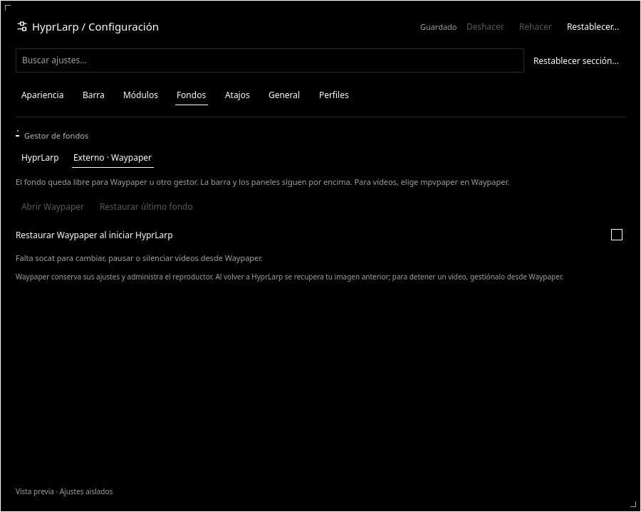

# Fondos externos y animados con Waypaper

En **Configuración → Fondos → Gestor de fondos** se puede elegir entre HyprLarp y Externo · Waypaper. El modo inicial sigue siendo HyprLarp. La imagen y la carpeta internas se conservan cuando se cambia de gestor.



## Usarlo

1. Abre configuración con Super + Coma y entra en Fondos. También puedes añadir el módulo Fondos a la barra o abrir su panel con Super + W.
2. Selecciona **Externo · Waypaper**. Se retira la superficie de fondo de HyprLarp para que no tape al gestor externo. La barra y los paneles mantienen sus capas.
3. Pulsa **Abrir Waypaper**, selecciona una carpeta y elige un fondo. Para vídeos selecciona **mpvpaper** como backend dentro de Waypaper. Para animaciones GIF también puedes usar un backend compatible como awww.
4. Si quieres recuperarlo al iniciar el shell, activa **Restaurar Waypaper al iniciar HyprLarp**. El botón **Restaurar último fondo** lo aplica inmediatamente.
5. Para volver a la imagen anterior, selecciona **HyprLarp**.

Waypaper, mpvpaper y socat son dependencias opcionales. En el equipo revisado ya están Waypaper 2.9 y mpvpaper 1.9; falta socat para cambiar, pausar o silenciar vídeos mediante el cliente mpvpaper de Waypaper. En Arch/CachyOS puedes instalarlo con:

```sh
sudo pacman -S --needed socat
```

La opción vuelve a comprobar las herramientas al abrir o actualizar el panel. `hyprlarp doctor` también las muestra. Los paquetes no se instalan desde el shell.

## Estado y recursos

- El modo externo destruye la ventana de fondo interna y vacía el modelo de miniaturas. No carga dos imágenes de fondo del shell ni consulta continuamente el estado de Waypaper.
- Abrir Waypaper ejecuta su programa con argumentos fijos; conserva su carpeta, backend, opciones y configuración propia. HyprLarp no reescribe sus archivos.
- Restaurar ejecuta `waypaper --restore`, usando el último backend elegido. La restauración automática está desactivada inicialmente y solo se programa al iniciar el shell si se activa. No se ejecuta automáticamente en la vista previa ni en la app independiente de configuración.
- Waypaper administra los reproductores externos. Volver al fondo interno no mata esos procesos; para detener o cambiar un vídeo, usa Waypaper. Si ya restauras Waypaper desde otro mecanismo de inicio, puedes dejar desactivada la restauración de HyprLarp.
- Los cambios de proveedor y restauración admiten Deshacer/Rehacer y Restablecer sección desde configuración. Los botones de abrir/restaurar son acciones explícitas y no se reproducen al deshacer ajustes.
- La vista previa muestra un indicador de fondo externo; no intenta capturar ni reproducir el vídeo de otro proceso. El coste de un vídeo depende del backend, resolución, FPS y hardware.

## Comprobaciones

Las pruebas cubren persistencia, conservación de la imagen, cambio de proveedor, deshacer/rehacer, reset de Fondos, liberación del modelo de imágenes, ausencia de lecturas del catálogo en modo externo, argumentos fijos al abrir/restaurar, errores y exclusión de la restauración automática en vista previa/configuración independiente. Los programas externos están simulados en las pruebas: no se abrió Waypaper ni se aplicó ningún vídeo.

La reproducción, las capas Wayland y el control de mpvpaper requieren una sesión real. El entorno de comprobación no permite conectar con los sockets de Hyprland/Wayland.

Las opciones se contrastan con el [uso oficial de Waypaper](https://github.com/anufrievroman/waypaper-docs/blob/main/usage.md), la [configuración de vídeo](https://github.com/anufrievroman/waypaper-docs/blob/main/configuration.md#video-options) y el paquete [socat de Arch](https://archlinux.org/packages/extra/x86_64/socat/).
