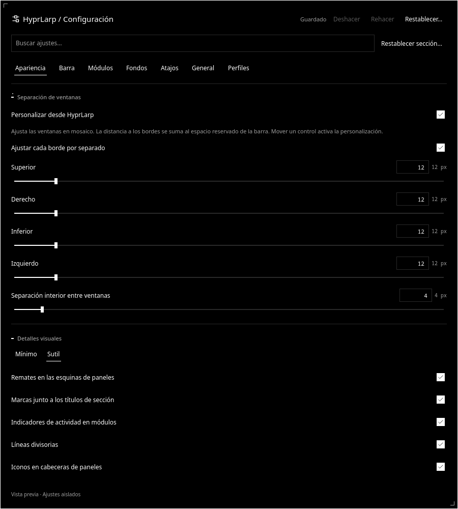

# Separación de ventanas

Abre **Configuración → Apariencia → Separación de ventanas**.

- **Distancia a los bordes de la pantalla**: aplica el mismo espacio exterior en los cuatro lados, entre 0 y 128 px.
- **Ajustar cada borde por separado**: muestra los controles superior, derecho, inferior e izquierdo. Al volver al valor común se utiliza el valor del borde superior.
- **Separación interior entre ventanas**: controla `general.gaps_in`, entre 0 y 64 px. Hyprland lo distribuye alrededor de cada ventana: el espacio entre dos ventanas puede sumar ambas contribuciones.

Mover un control activa **Personalizar desde HyprLarp**. Los cambios se aplican automáticamente y se guardan con el resto de preferencias. Deshacer, Rehacer y Restablecer sección están disponibles dentro de configuración; un arrastre completo cuenta como un cambio.

Para volver a tus valores originales, desactiva **Personalizar desde HyprLarp**. Se recarga la configuración del compositor después de desactivar la integración. Los controles conservan sus últimos valores para poder recuperarlos al activarla de nuevo.

La separación exterior se añade a la zona reservada de la barra. No mueve ventanas flotantes ni cambia las reglas de pantalla completa. Una regla específica de workspace puede prevalecer sobre los valores globales.

## Persistencia

El instalador genera `~/.config/hyprlarp/window-gaps.conf`, un pequeño archivo de datos validado. La integración `hyprlarp.lua` lo carga al iniciar o recargar Hyprland y el aspecto opcional del rice vuelve a aplicarlo después de sus valores base. Las actualizaciones interactivas usan `hyprctl eval` y no requieren recargar el compositor en cada movimiento.

No hace falta editar ese archivo a mano. No contiene código ejecutable; el lector rechaza campos desconocidos, valores fuera de rango, duplicados y archivos de más de 1 KiB. Si la aplicación falla, Apariencia muestra el error y ofrece **Reintentar aplicación**; las preferencias guardadas se conservan.

La personalización está desactivada inicialmente. No añade sondeos, temporizadores ni procesos residentes.
